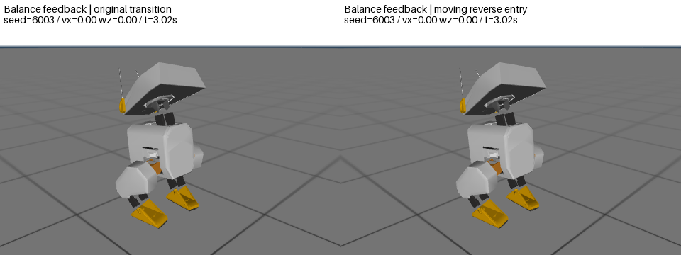

# 从单摆到双足行走 · MuJoCo 机器人控制作品集

在 MuJoCo 中，我先用一个单摆建立从物理模型到闭环验证的基础，再把这套方法用于 Open Duck Mini v2。双足阶段实现了可用手柄控制的站立、前进、转弯和低速后退，并对命令过渡、头颈稳定、显存约束和评测复现做了专项优化。

[28 秒弧线与后退对照回放](media/moving_reverse_comparison.mp4) · [36 秒完整手柄路线](media/assisted_switch_comparison.mp4) · [20 秒头颈限速对照](media/neck-ablation.mp4)

## 面试速览

| 阶段 | 做了什么 | 可以核查的结果 |
|---|---|---|
| 01 · 单摆 | MJCF 模型 → P/PD → 重力补偿 → Gymnasium → SB3 PPO | 目标 `0.5 rad` 时，重力补偿将纯 PD 的稳态误差从 `0.0884 rad` 降到约 `3.4×10⁻⁷ rad`。单摆 PPO 采集 `200,704` 步，最佳模型在 10 个测试种子上的平均回报 `375.90`。 |
| 02 · 双足 | 环境与课程设计 → MJX/Brax PPO → 示范监督 → 原生 MuJoCo 评测与手柄 | 头颈方案在 80 局基础命令中均达标，头颈关节速度 RMS 从 `1.2473` 降到 `0.3481 rad/s`。同种子的直走/后退互换从 `1/20` 提高到 `15/20` 达标，新版有 `18/20` 局跑满。 |
| 03 · 小蜘蛛 | 下一阶段，基于前两阶段独立建模与实现 | 计划复用环境接口、课程设计、检验方法和工程工具。 |

**最能体现调试过程的实验。** 第 22 轮 PPO 的同一检查点，直接给 `−0.05 m/s` 后退命令时 `8/8` 跑满，逐渐变到同一目标时 `0/8` 跑满。最终演示把训练后的 Actor 与实测速度反馈、姿态修正和步态切入结合。标准路线平均后退 `−0.0508 m/s`。反复弧线换后退仍有偏航超差和个别跌倒，报告保留了这些样本。

## 阅读和运行

- [阶段 01 · 单摆与 PPO](docs/01-pendulum.md)
- [阶段 02 · Open Duck Mini 工程和训练](docs/02-duck.md)
- [完整时间线、实验索引与面试讲解](docs/03-timeline.md)
- [安装、运行与复现边界](docs/reproduce.md)
- [上游来源与贡献范围](docs/credits.md)

源码入口为 [`lessons/01_simulation_step.py`](lessons/01_simulation_step.py)、[`lessons/05_ppo.py`](lessons/05_ppo.py) 和 [`lessons/07_duck_ppo.py`](lessons/07_duck_ppo.py)。双足环境扩展见 [`extensions/`](extensions/)，实验数据见 [`evidence/`](evidence/)，验证好的权重和交互演示见 [`checkpoints/`](checkpoints/) 与 [`demo/`](demo/)。双足数据来自平地仿真。上游机器人设计、环境基础和公开模型见 [Open Duck Mini v2](https://github.com/apirrone/Open_Duck_Mini/tree/v2) 与 [固定版 Open Duck Playground](https://github.com/apirrone/Open_Duck_Playground/tree/b9be205ac64488c23504ca42e5ec790337adeec3)。
