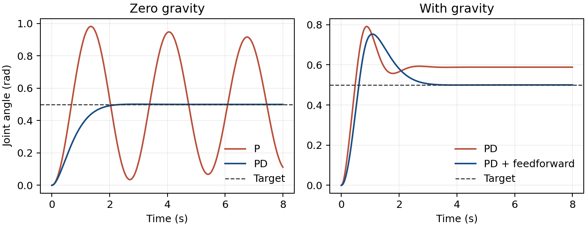

# 阶段 01 · 从单摆动力学到 PPO

本阶段建立单自由度 MuJoCo 模型，完成物理步进验证、闭环控制对照、Gymnasium 环境封装和 PPO 训练。实验记录角度、速度、力矩、仿真时间及分种子评测结果。

## 1. 模型和仿真步进 · 2026-10-29 至 10-31

[`models/pendulum.xml`](../models/pendulum.xml) 描述摆杆、转轴、质点、阻尼和环境。物理步长为 `0.002 s`。第一课通过 XML 添加电机，检查 `nq=nv=nu=1`，再记录 `qpos`、`qvel`、`qacc` 和仿真时间。[实验入口](../lessons/01_simulation_step.py) · [三组检查](../evidence/lesson01/checks.json)

| 条件 | 预期 | 实测 |
|---|---|---|
| 无重力，零输入 | 初始静止保持 | `2 s` 后位置、速度均为零 |
| 有重力，零输入 | 重力产生初始角加速度 | 初始角加速度约 `6.374 rad/s²` |
| 无重力，恒定 `1 N·m` | 电机驱动，阻尼与速度相关 | 初始角加速度约 `1.350 rad/s²`，`2 s` 后角速度约 `2.559 rad/s` |

这里建立的接口关系可直接迁移到机器人。`MjModel` 持有模型描述，`MjData` 持有当前状态。`data.ctrl` 是执行器输入。`mj_step` 推进时间，`mj_forward` 依据当前状态更新派生量。CPU 实际耗时和仿真时间分开记录。

## 2. P、PD 和重力补偿 · 2026-10-31 至 11-01

先在无重力条件下把目标设为 `0.5 rad`。保持同一个模型、初始状态和力矩饱和边界，比较 `Kp=4`、`Kd=0` 与 `Kp=4`、`Kd=3`。在这组增益与时长下，P 组仍有明显振荡。PD 组最后一秒最大误差约 `5.69×10⁻⁷ rad`，P 组约 `0.388 rad`。此处比较的是这组条件下的瞬态表现。[PD 实验](../lessons/02_pd_control.py) · [结果和轨迹](../evidence/lesson02)

随后恢复重力。纯 PD 在最后接近静止，但需要位置偏差来产生平衡力矩，实测稳态偏差约 `0.0884 rad`。重力补偿组用当前位置重算偏置力矩，在误差接近零时仍提供约 `−1.057 N·m`。终值误差降到约 `3.44×10⁻⁷ rad`。控制饱和也单独记录，以免把瞬态差异误判为控制律差异。[补偿实现](../lessons/03_gravity_compensation.py) · [实测结果](../evidence/lesson03/checks.json)

## 3. 把物理过程封装成 RL 环境 · 2026-11-02

[`PendulumEnv`](../lessons/pendulum_env.py) 把控制任务拆成 `reset(seed)`、观测、`step()`、奖励和终止条件。策略每 `0.02 s` 输出一次动作，MuJoCo 在这段时间内执行 10 次物理步。动作映射到有上限的力矩，执行后才用新的物理状态计算位置、速度、力矩与失败代价。环境同时记录正常时间截断与物理失败。

训练前先跑随机控制和已知可用的 PD。相同 `400` 个环境步、`8 s` 的示例里，随机策略回报 `−6.48`，PD 为 `373.97`。用这两个参照检查奖励方向、动作限幅与时间边界，再开始 PPO。[验收脚本](../lessons/04_rl_environment.py) · [环境验收](../evidence/lesson04/checks.json)

## 4. 单摆 PPO · 2026-11-02

[`05_ppo.py`](../lessons/05_ppo.py) 使用 Stable-Baselines3。Actor 和 Critic 都是两层 64 单元，4 个并行环境，`n_steps=256`，训练种子 42。每个环境先采一个 rollout，优化器用优势估计和价值目标更新，再采下一批。用验证种子挑模型，最终用 `1000–1009` 独立比较未训练、最佳、最终策略和 PD。请求训练 `200,000` 步，实际按完整 rollout 采集 `200,704` 步。[配置](../evidence/lesson05/config.json) · [验证轨迹](../evidence/lesson05/validation.csv)

| 控制器 | 10 个测试种子平均回报 | 最差尾段角度误差 |
|---|---:|---:|
| 初始化 Actor | 58.93 | 0.62659 rad |
| 验证集选出的 PPO 模型 | 375.90 | 0.01512 rad |
| 最终 PPO 模型 | 375.19 | 0.04246 rad |
| PD 参照 | 370.32 | 约 2.56×10⁻⁷ rad |

这个对照暴露了目标设计的取舍。PPO 的综合回报更高，PD 的尾段角度精度明显更好。回报把控制过程和力矩等多项折在一起，验收仍要看角度、速度和失败次数。保存前后还用固定观测比较动作，校验模型确实能够重载。[逐种子评测](../evidence/lesson05/evaluation.json) · [重载与验收](../evidence/lesson05/checks.json)
