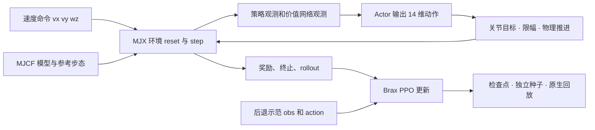

# 阶段 02 · Open Duck Mini v2 双足运动控制

## 范围和个人工作

本阶段在 Open Duck Mini v2 的 MuJoCo 模型、参考步态和上游环境基础上进行。我的工程工作包括环境接口核对、低速课程设计、奖励和命令重置修正、PPO 训练与检查点恢复、头颈目标限速、后退示范监督、手柄过渡控制，以及 MJX 和原生 MuJoCo 对照评测。模型资产和参考步态由上游提供。项目在仿真中完成。[来源声明](credits.md)

## 数据如何流动

1. **场景与状态。** 平地 XML 载入机身、关节、执行器与接触几何。独立的模型验收测到 `nq=21`、`nv=20`、`nu=14`。根自由关节的位置包含四元数，位置与速度的维数不同。`home` 关键帧给出站姿和初始目标。[模型验收代码](../lessons/06_duck_model.py) · [执行器地址和单位](../evidence/lesson06/model_report.json)
2. **重置与命令。** 重置从 `home` 出发，按所选配置施加扰动。命令由 `vx`、`vy`、偏航角速度组成，课程控制活动范围、占比和切换。后续版本将目标命令与逐步生效的命令分开，并保持 `step` 后的观测和任务状态一致。[课程代码](../extensions/playground/open_duck_mini_v2/profiles/locomotion_combined.py) · [缓变命令](../extensions/playground/open_duck_mini_v2/profiles/locomotion_combined_slew.py)
3. **观测与执行。** Actor 用 IMU、命令、关节状态、动作历史、接触和步态相位等信息。后续平衡版本从原本用于头部命令的槽位提供身体重力方向和局部速度。Critic 可以使用更多状态信息。Actor 输出 14 维动作，经缩放为关节目标，结合当前目标做变化率限制。一个 `0.02 s` 控制周期内推进 10 次 `0.002 s` 的物理步。[基础接口](../extensions/playground/open_duck_mini_v2/locomotion.py) · [平衡观测](../extensions/playground/open_duck_mini_v2/profiles/locomotion_combined_balance.py)
4. **奖励和 PPO。** 用机体坐标系中的线速度、偏航速度和命令计算跟踪奖励，结合动作变化、力矩、参考运动、失败等项。站立看实际瞬时运动，周期步态分析则另看平滑速度。Brax 的 rollout 分别给 Actor 和 Critic 提供策略和价值更新信号，保存网络与归一化器。接续训练恢复这些参数，优化器重新初始化。[奖励实现](../extensions/playground/open_duck_mini_v2/locomotion.py) · [训练入口与持久化](../lessons/07_duck_ppo.py)
5. **示范监督。** 对成功过渡的 `(obs, action)` 样本加动作均方误差，作用在 Actor 预测上。环境奖励通道继续存在。训练日志分别记录 `demonstration_mse`、策略损失和价值损失，这使失败归因能具体到训练信号。[损失实现](../lessons/ppo_demonstration_anchor.py) · [第 22 轮进度](../evidence/duck/rounds/round-22/progress.jsonl)

## 三次有代表性的工程决策

### ① 测量走得怎么样，再优化分数

对基础前进用同一组站立与三档速度命令验收。一个 `102.4M` 步追加训练的分支，所选检查点在 32 局基础命令中全部通过。更严的联合扰动测试只有 `2/16` 达标、`14/16` 发生物理失败。强噪声、姿态扰动和推力同时变化，实验能测出鲁棒性差距，单项归因需要额外消融。接触切向速度的代理指标也有退步。教学结论是把速度、稳定和接触质量分开评审。[前进和停稳的历史结果](03-timeline.md#阶段-02--模型前进头颈转向后退)

### ② 先做头颈限速消融，再决定是否追加训练

原策略、同权重直接限速、限速后接续训练三组使用相同的 20 个检验种子与 4 档指令。限制的是 4 个头颈执行器目标变化率，`0.5 rad/s` 对应每个控制周期最多 `0.01 rad`。实际关节速度和世界坐标中头部角速度另外测量。

| 条件 | 基础通过 | 实际头颈速度 RMS | 平面跟踪误差 RMS |
|---|---:|---:|---:|
| 原策略 | 80/80 | 1.2473 rad/s | 0.0044 m/s |
| 直接限速 | 80/80 | 0.3601 rad/s | 0.0064 m/s |
| 限速后训练 | 80/80 | 0.3481 rad/s | 0.0042 m/s |

这组对照表明直接限速已明显减少头部动作，但会牺牲一部分速度跟踪。接续训练后恢复了基础跟踪精度，世界头部 RMS 仍单独分析。并行容量也实测。8,192 并行环境短测能完成更新和重载，长跑触发显存余量保护，正式续训回退到 4,096。第 22 轮使用 2,048 并行环境，追加 `10,076,160` 步，整卡显存峰值 `2,103 MiB`。 [头颈指标](../evidence/duck/neck/final_metrics.json) · [限速代码](../extensions/playground/open_duck_mini_v2/profiles/locomotion_neck.py) · [资源保护记录](../evidence/duck/guards/round22_guard.json)

### ③ 把后退动作与进入后退分开测

作者的环境采样允许负前向速度。公开 ONNX 在我们的 `−0.05 m/s` 平地标准路线里实测接近 `0 m/s`。本地测试进一步区分固定命令与缓变命令。同一第 22 轮 Actor 在直接阶跃时 `8/8` 跑满，平均约 `−0.053 m/s`，缓变时 `0/8`。现象把排查重点缩小到换向时的低速区、身体初始状态和步态相位。仅凭这组对照无法给上游权重的行为归因到具体训练参数。[阶跃数据](../evidence/duck/round22_native_final.json) · [缓变数据](../evidence/duck/round22_native_final_ramp.json)

交互演示选用另一个经过验证的示范初始化 Actor。站立和正常行走由 Actor 与有限的姿态反馈运行。检测到从行进进入后退时，加入速度相关的短暂等待，最长约 `0.20 s`，再从选定相位混入参考后退步态。俯仰修正用姿态和角速度，速度修正用滤波后的实测速度与目标之差，最后把修正加到髋和踝的目标角。运行时不更新权重。[手柄控制循环](../demo/native_assisted_gamepad.py) · [过渡分支](../demo/probe_moving_reverse.py) · [髋踝速度修正](../demo/fit_reverse_entry.py)

## 最终同种子对照

原生 MuJoCo 50 Hz、平地、相同种子和各段命令。每条路线 20 个种子。全程达标要求无跌倒，且每个评分段的速度和偏航在容差内。跑满单独统计。作者使用发布的 ONNX，本地使用各自控制器。表格衡量这些任务条件下的表现。

| 路线 | 原辅助版达标 | 新版达标 | 新版跑满 | 作者跑满 / 达标 |
|---|---:|---:|---:|---:|
| 标准完整切换 | 17/20 | 17/20 | 20/20 | 20/20 / 0/20 |
| 直走与后退互换 | 1/20 | 15/20 | 18/20 | 20/20 / 0/20 |
| 弧线与后退反复切换 | 0/20 | 11/20 | 20/20 | 20/20 / 0/20 |
| 反向弧线与后退反复切换 | 0/20 | 10/20 | 19/20 | 20/20 / 0/20 |

标准路线后退速度，本地新版为 `−0.0508 m/s`，作者权重约 `−0.0001 m/s`。本地路线中仍有少数跌倒和持续偏航。另试过偏航增益调整，它在独立种子上降低了直走/后退整条路线的达标次数，最终便保留此前设置。代码和报告也记录这一失败尝试。[本地逐段数据](../evidence/duck/reverse_moving_entry_matched.json) · [上游逐段数据](../evidence/duck/author_moving_entry_matched.json) · [偏航复测](../evidence/duck/reverse_moving_yaw_probe.json)
