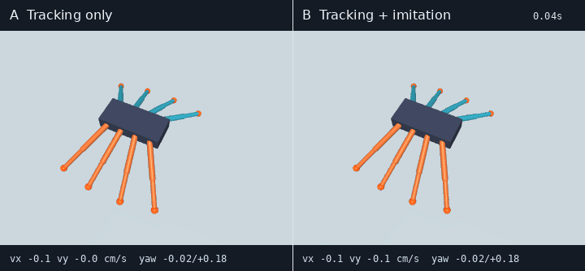

# 小蜘蛛 · MuJoCo 八足运动控制

一个从单腿 MJCF 起步的八足仿真项目。16 个位置执行器驱动 8 条双铰链腿，策略跟踪机身速度指令 `(vx, vy, wz)`，可以调速、前进、后退、横移、转向和走弧线。训练使用 MJX/Brax PPO，预训练策略可用 Windows 手柄在原生 MuJoCo 中驾驶。



平地左弧线回放。视频中的两组各训练 `3,145,728` 个控制步，均通过这条路线。[逐条速度与接触记录](../evidence/spider/flat-command-evaluation.json)

## 快速运行

在 Windows PowerShell 中从仓库根目录执行。使用 Python 3.12、MuJoCo 和 NumPy 即可加载预训练策略。

```powershell
py -3.12 -m venv .venv-spider
.\.venv-spider\Scripts\python.exe -m pip install mujoco==3.2.7 numpy==1.26.4
.\.venv-spider\Scripts\python.exe lessons/spider_command_viewer.py
```

默认加载 A 组。传入 `checkpoints/spider-command-b-1048576/checkpoint.npz` 可体验 B 组。左摇杆前后与横移，右摇杆转向，`LB/RB` 换档，`A` 重置。键盘对应 `W/S`、`A/D`、`Q/E`、`Z/X`、`R`。

在最后一条命令加 `--check`，可无窗口验证八项基本动作。用同一个 Python 运行 `lessons/spider_standing.py` 和 `lessons/spider_walk.py`，可以分别检查站姿和手写步态。Viewer 也支持 `--action-delay 2 --sensor-delay 2 --noise-seed 131`，对应各 `40 ms` 的动作、观测延时和可复现的传感器噪声。

## 平地验收

19 条标准路线覆盖停止、三档前进与后退、三档左右横移、原地转向、弧线与前后换向。原生 MuJoCo 用机身位移和偏航变化计算速度。达标要求各评分段满足速度容差及稳定性条件，跑完另行统计。[验收实现](../lessons/spider_command_eval.py)

| 策略 | 跑完 | 达标 | 平均纵向误差 | 平均横向误差 |
|---|---:|---:|---:|---:|
| [A · 524,288 步](../checkpoints/spider-command-a-524288/) | 19/19 | 19/19 | 1.01 mm/s | 0.49 mm/s |
| [B · 1,048,576 步](../checkpoints/spider-command-b-1048576/) | 19/19 | 19/19 | 1.16 mm/s | 0.49 mm/s |
| A · 3,145,728 步 | 19/19 | 18/19 | 1.60 mm/s | 0.58 mm/s |
| B · 3,145,728 步 | 19/19 | 18/19 | 1.67 mm/s | 0.63 mm/s |

A 和 B 从同一个动作示范热启动。A 使用速度跟踪和跌倒惩罚。B 另加参考动作与接触、滑动、姿态等奖励及示范监督。发布的两个检查点都来自训练早期，在这套验收上达标数更高。它们的训练步数不同，奖励方案的同预算比较见[各检查点评测](../evidence/spider/flat-command-evaluation.json)。

另以两组各 `524,288` 步的同预算检查点测试延时和噪声，再各追加 `524,288` 步。追加前后，两组在五组平地测试条件下都达标 `19/19`，包括动作和观测同时延时 `40 ms` 并加入噪声。记录保留了两个测试噪声种子的偏航误差。[扰动对照](../evidence/spider/flat-disturbance-evaluation.json)

## 训练复现

在 Linux 或 WSL2 Ubuntu 下使用 Python 3.12 和 CUDA 12。仓库提供实际实验使用的纵向控制检查点。训练脚本以它为输入，采集多指令示范并拟合共同热启动，随后运行 A/B 两组课程。每组依次训练纵向、横移与转向、混合指令三个阶段。`--stage-steps` 是每组每阶段的环境步数。

```bash
python3.12 -m venv .venv-duck
.venv-duck/bin/python -m pip install -r requirements/requirements-duck.lock
MUJOCO_GL=egl MPLBACKEND=Agg XLA_PYTHON_CLIENT_PREALLOCATE=false \
  .venv-duck/bin/python lessons/spider_train_commands.py \
  checkpoints/spider-axial-warm-start.params \
  --envs 4096 --stage-steps 1048576 --seed 0
```

要先检查训练入口，可以用 `--envs 8 --stage-steps 128`。输出目录 `artifacts/spider_ppo/command-ab-*/` 保存检查点、示范、训练日志和原生评测。扰动续训用 `lessons/spider_train_disturbances.py --source-run <实验目录> --start-step 524288`，该步数对应上面的正式训练设置。[报告所用 PPO 日志](../evidence/spider/flat-ppo-progress.jsonl)

## 代码入口

| 环节 | 实现 |
|---|---|
| 单腿与八足模型 | 单腿髋绕局部 x、膝绕局部 z，复制成带 `home` 站姿的八足模型。`nq=23`，`nv=22`，`nu=16`。[单腿 MJCF](../models/spider_single_leg.xml) · [八足建模与站立](../lessons/spider_standing.py) |
| 步态和示范 | 两组交错腿相差半个周期，直走步态周期 `1.2 s`。手写步态负责生成示范，动作监督拟合初始 Actor。[直走步态](../lessons/spider_walk.py) · [多指令模板](../lessons/spider_command_gait.py) · [热启动](../lessons/spider_command_warm.py) |
| 环境和控制 | `reset` 恢复 `home`。`step` 将 Actor 动作转为关节位置目标，每 `20 ms` 更新一次，周期内推进十个 `2 ms` 物理步。多指令模式使用 61 维观测。[MJX 环境](../lessons/spider_mjx_env.py) · [指令与奖励](../lessons/spider_command_env.py) · [坐标变换和观测](../lessons/spider_command_task.py) |
| 训练、评测与回放 | [A/B PPO](../lessons/spider_train_commands.py) · [扰动续训](../lessons/spider_train_disturbances.py) · [原生验收](../lessons/spider_command_eval.py) · [导出 NumPy 权重](../lessons/spider_export_command.py) · [Windows Viewer](../lessons/spider_command_viewer.py) |
